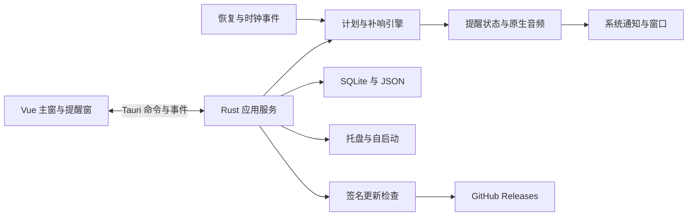

# onTime 技术开发说明书

日期：2026-10-09。状态：拟议方案，与《项目说明书》对应；尚未实现。正式名称、应用标识和发布仓库待确认。

## 1. 技术决策

| 事项 | 方案 | 状态与理由 |
| --- | --- | --- |
| 平台 | Windows / macOS | 已确认；最低版本及架构待确认 |
| 前端 | Vue 3、TypeScript、Vite、Pinia、Vue Router、Tailwind CSS、shadcn-vue | Vue/TS 已确认，其余遵循指定模板 |
| 桌面后端 | Tauri 2 + Rust | Tauri 已确认，具体主版本与后端方案为建议 |
| 调度 | Rust 权威状态与截止队列 | 建议；不依赖 WebView 生命周期 |
| 数据 | JSON 配置 + SQLite 业务 | 建议；事务服务实例去重与批量操作 |
| 数据根目录 | 首次由用户选择 | 已确认；定位文件放平台目录为建议 |
| 日历 | 中国大陆日历与离线缓存 | 已确认；来源待确认 |
| 补响 | 恢复/启动最近 30 分钟，较早只记录 | 已确认 |
| 同步/账号 | 不实现 | 已确认 |
| 分发与更新 | GitHub Releases 稳定渠道 + 检查更新 | 技能默认要求，具体更新器为建议 |

本文件保留需求对应的设计规范；当前实现已进入开发验收阶段，实际构建与测试证据见开发进度.md。依赖锁定于 pnpm-lock.yaml 和 Cargo.lock，组件配置及源码随项目提交。

## 2. 架构与模块



| 模块 | 职责 | 需求 |
| --- | --- | --- |
| alarms/repository | CRUD、复制、事务开关 | FR-001–002、FR-015 |
| schedule | 时间、重复规则、下次触发 | FR-003–006 |
| occurrences/scheduler | 实例状态、贪睡、补响、记录 | FR-004、FR-007、FR-013、FR-019 |
| audio/alerts | 通知、提醒窗、音频、渐强、时长 | FR-008–010 |
| platform | 托盘、自启动、单实例、电源恢复 | FR-011–013 |
| tags | 分类、颜色、筛选 | FR-014–015 |
| storage/backup | 目录、保存、迁移、备份 | FR-016–017 |
| updater | 稳定渠道、下载校验与安装 | FR-018 |

Pinia 仅缓存界面状态；Rust 是持久化与调度的权威。关闭主窗口隐藏，不退出进程。提醒窗独立于主窗，页面定时器只刷新显示。

## 3. 拟议工程结构与模板约定

```text
src/
  App.vue
  main.ts
  style.css
  router/index.ts
  stores/
  views/
  features/
  components/ui/
  lib/
src-tauri/
  src/commands/
  src/domain/
  src/services/
  src/storage/
  src/platform/
  capabilities/
  migrations/
  resources/
```

Composition API + script setup lang="ts"；SFC 顺序 script、template、必要的 style。App.vue 负责外壳与 RouterView；Pinia setup store，computed 派生值。TypeScript/Vite 的 @ 别名一致。

先按官方 Vite Vue/TS 模板配置并验证；Tailwind 使用当前 Vite 插件方案，shadcn-vue CLI 初始化 Neutral。先添加 Button，再添加 Input、Label、Card、Dialog、Dropdown Menu、Select、Table、Badge、Separator、Skeleton、Tooltip。初始页面验证组件、路由与真实 Pinia action，再进入业务开发。[shadcn-vue 官方安装](https://www.shadcn-vue.com/docs/installation/vite)、[Tailwind Vite 安装](https://tailwindcss.com/docs/installation/using-vite)。

build 包含 vue-tsc 类型检查。.gitignore 覆盖 node_modules、dist、日志、本地环境；不忽略锁文件、components.json 和 UI 源码。

## 4. 数据目录与生命周期

```text
<用户选择的数据根目录>/
  config.json
  data.db
  resources/sounds/
  calendar/ # 旧版兼容数据，当前不参与调度
  logs/
  backups/
```

安装包内铃声与程序资源只读；用户导入资源复制到自选目录，以相对路径引用。建议平台 appDataDir 仅保存 bootstrap.json 定位文件：Windows 通常 %APPDATA%/<应用标识>/，macOS 通常 ~/Library/Application Support/<应用标识>/。最终通过 Tauri 路径 API 获取，具体标识待确认，首次明确说明。

首次规范化路径、验证创建/写入、目录锁、现有数据版本；未知内容不覆盖，已有有效库可选择打开。拒绝 .app 内部目录。不以管理员日常运行解决写入。自选目录断开或权限失效时暂停不能持久化的变更和新触发，明确告知并重新定位，不静默建立空库。

JSON 同目录临时文件、刷盘、原子替换并保留恢复副本；SQLite 事务提交成功后才反馈保存并重算计划。迁移前暂停调度、生成一致性快照，用 schema_version 管理。不支持的高版本库拒绝打开，迁移失败保留原数据和备份。

备份包含配置、SQLite 一致性快照、资源、日历与校验清单；不直接复制正在写入的数据库。导入先临时解包、校验版本和引用，拒绝绝对路径与 ../，备份现有数据后替换。跨平台不恢复系统权限/自启动。目录迁移先复制验证，再改定位，旧目录删除需明确用户操作。

建议日志 5 MB 轮转最多 5 份；提醒历史长期保留，由用户通过 SQLite 数据库与备份管理。升级/卸载保留自选数据目录，清理不得把数据当作安装文件删除。

## 5. SQLite 数据模型与接口

业务数据保存在所选数据目录的 `data.db`，schema 版本使用 `PRAGMA user_version` 管理，当前为 v5。外观等设置独立保存在设置配置中，不混入业务库。v4 将“月底”单独编码为 `monthly_day=0`；旧版 31 号曾按月底处理的规则会在迁移中转为月底，新建的自定义 31 号仅匹配有 31 天的月份。v5 为提醒历史增加可筛选的结构化列与索引，旧数据库在事务中迁移并回填，不丢失已有记录。

| 表 | 字段/约束 | 用途 |
| --- | --- | --- |
| `alarms` | `id` 主键、`title`、`content`、`enabled`、`kind`、`time`、`date`、`repeat`、`monthly_day`、`effective_start`、`effective_end`、`weekdays`、`duration_seconds`、`deadline`、`sound`、`volume`、`gradual`、`ring_seconds`、`snooze_limit`、`group_id`、`revision`、`created_at`、`next_at`、`json` | 提醒规则；JSON 保存完整兼容载荷，独立列为常用条件和索引提供投影。旧库可能保留未使用的 `skip_holidays` 列 |
| `groups` | `id` 主键、`name`、`color`、`created_at`、`json` | 提醒分组 |
| `tags` | `id` 主键、`name`、`color`、`created_at`、`json` | 标签 |
| `alarm_tags` | `alarm_id`、`tag_id` 组成联合主键；分别外键关联 `alarms`、`tags`，删除上级时级联删除 | 提醒和标签的多对多关系 |
| `alarm_groups` | `alarm_id` 主键、`group_id`；分别外键关联 `alarms`、`groups`，删除上级时级联删除 | 提醒和分组的一对多归属关系 |
| `occurrences` | `id` 主键（一次触发实例）、`alarm_id`（保留来源标识，不设级联外键）、`scheduled_at`（计划触发 Unix 秒）、`title`（触发时标题快照）、`status`、`snooze_count`、`started_at`、`updated_at`、`json` | 当前响铃/贪睡实例和长期提醒历史；保留快照，提醒删除或改名后历史仍可读 |

提醒、分组、标签和历史行以 JSON 作为兼容载荷；SQLite 触发器同步常用字段投影，避免业务读写和索引字段漂移。历史按标题/状态/计划时间筛选并在 SQL 层分页，索引包括 `(status, scheduled_at DESC)` 和标题；历史不按 90 天自动清理。v1–v3 升级到 v4、v4 升级到 v5 前创建迁移快照并在事务中迁移；导出备份包括提醒、分组、标签、完整历史和铃声，不导出外观等设置。每天首次启动会在 `backups/` 创建一份完整本地备份，保留最近 7 份。

命令：提醒/标签/分组 CRUD、复制、开关/批量开关、停止/贪睡实例、导入/试听音频、选择/打开数据根目录、导出/导入备份、检查/安装更新。返回实体版本、下次触发与可辨识错误；并发冲突要求重新读取。

事件：state-changed、storage-error、audio-error、update_progress。包含必要 id/版本，重连全量读取快照，不以事件为唯一数据源。Rust 校验所有输入和授权路径。

## 6. 调度与可靠性

Rust 维护最近截止队列，规则变更、恢复、时钟/时区变化时重算，避免逐提醒高频轮询。按系统星期及显式重复星期计算，不使用节假日日历。

定点按系统时区计算，时间回拨不重复已处理实例。DST 不存在时间建议顺延，重复时间只安排一次。倒计时建议计入睡眠：持久化 UTC 截止，运行期使用单调时钟，检测调钟后对齐截止；重启期间系统时间改变存在精度边界，需测试并说明。

恢复/启动统一 reconcile(now)：读取有效规则与未终结实例；事务认领最近 30 分钟（含边界）的漏响；进入提醒队列；更早记录过期摘要；计算未来实例。禁用、删除、取消、已完成计划不补响。重复恢复与多信号合并串行协调，唯一约束防重；长期停机按日期范围归纳，不逐秒遍历。

状态机：pending → ringing → dismissed/auto_stopped；ringing → snoozed → ringing；取消 cancelled；超窗 skipped_expired。贪睡持久化新截止与次数，不修改基础规则。多个提醒共用音频通道，逐项处理。

数据库事务与播放副作用不能严格保证 exactly-once；崩溃遗留 ringing 实例需可见恢复处理，既不宣称绝对去重，也不静默丢弃。

Windows 拟桥接 WM_POWERBROADCAST/PBT_APMRESUMEAUTOMATIC；macOS 观察 NSWorkspace.didWakeNotification。增加低频时钟间隔异常检测作补充，具体桥接与睡眠/休眠模式需实机验证；这些是恢复信号，不代表主动唤醒。[Microsoft 恢复事件](https://learn.microsoft.com/en-us/windows/win32/power/pbt-apmresumeautomatic)、[Apple 恢复通知](https://developer.apple.com/documentation/appkit/nsworkspace/didwakenotification)。

## 7. 音频与平台集成

采用 Tauri 通知、提醒窗、托盘、自启动能力。Windows 通知需安装应用验收；拒绝通知仍可应用内提醒。主窗隐藏继续运行，显式退出保存状态、停止音频、释放锁。自启动默认关闭并查询实际状态；macOS 登录自启场景的更新重启专门验证。[通知](https://v2.tauri.app/plugin/notification/)、[托盘](https://v2.tauri.app/learn/system-tray/)、[自启动](https://v2.tauri.app/plugin/autostart/)。

音频建议 Rust 原生播放，具体库、格式与设备切换行为待双平台原型验证。导入限制大小和解码能力，损坏回退内置音频；渐强只调播放器增益。音频线程不阻塞调度/数据库；无设备保留弹窗并记录错误。

## 8. 隐私与安全

无业务服务器/账号。HTTPS 更新不携带提醒数据，限制下载大小与超时。Tauri capabilities 最小授权，限制文件操作至用户授权目录。日志避免标题正文和完整个人路径。归档解包防路径穿越，客户端不存签名私钥或发布令牌。

## 9. 构建、安装与更新

建议 Windows x86_64 NSIS .exe、macOS aarch64/x86_64 DMG/.app，最终架构/最低系统待确认，非已确认承诺。Windows 安装器可选目录；macOS 说明 .app 放置行为。系统 WebView 依赖需纳入安装策略。

CI 在匹配系统构建，执行前端类型检查/构建、Rust 格式/静态检查和规则测试。Windows 签名、macOS 签名/公证条件待确认；系统签名与 updater 签名不同。

建议 Tauri updater 读取 GitHub Releases 独立 latest.json；仓库/端点待确认，不把 Release 页面或 API 直接当框架清单。清单含 SemVer version 与 platforms.<os-arch>.url/signature；稳定渠道排除预发布，默认只接受更高版本。CI 生成 updater artifacts、签名和匹配元数据，客户端公钥校验，私钥/令牌仅 CI 密钥环境。[Tauri 更新文档](https://v2.tauri.app/plugin/updater/)。

建议手动检查，显示当前/最新、说明、无更新或失败；用户确认后下载/安装。下载失败保留当前程序，坏清单/签名拒绝安装。安装前保存并暂停提醒，权限失败提示重试/完整安装包。重启后迁移，失败保留快照和恢复说明；不兼容数据库降级拒绝打开。

## 10. 测试与发布验收

| 类别 | 场景 |
| --- | --- |
| 规则 | 每周无预选项、月底与 31 号区分、每月/季度/年度边界、时区/DST、时间回拨 |
| 补响 | 29:59/30:00/30:01、启动、重复恢复、禁用/删除、崩溃、贪睡持久化 |
| 数据 | 无权限、磁盘满、目录断开、版本不兼容、迁移失败、备份/导入安全 |
| 提醒 | 同时到期、渐强、超时、音频损坏/设备缺失、通知拒绝、主窗隐藏 |
| 安装 | 双平台安装启动、目录写入、托盘、自启动、睡眠/休眠、支持架构 |
| 更新 | 无更新、离线、坏清单/签名、下载中断、权限、重启、升级保留 |

开发先 pnpm build（包含类型检查），再启动服务验证组件、样式、路由、Pinia，结束后停止服务。规则用确定性时钟测试，安装包实机验收系统能力，不以浏览器模拟代替。

轻量化预算未确认。建议普通运行触发误差 ≤2 秒、恢复可用后 5 秒内协调、100 个提醒后台平均 CPU <1%；需固定硬件/测量窗口。内存和包体积统计包含 WebView 依赖后再定预算；上述为建议目标。

## 11. 实施与未决事项

顺序：模板/Tauri 外壳 → 数据/调度/恢复原型 → 日历/音频/贪睡/标签/记录 → 备份/签名更新/双平台安装验收。全部仍属第一版。

风险：电源桥接、音频兼容、日历权威与可用性、自选目录失效、签名更新、崩溃副作用。发布前确认正式名称/标识、最低系统与架构、GitHub 仓库、日历来源授权、签名公证、音频支持范围和性能预算。
## 实施决策补充（2026-10-09）
正式名称已确认为 onTime，应用标识 com.yeyongzhi.ontime，仓库 https://github.com/yeyongzhi/onTime。首版更新采用 GitHub Releases 引导下载完整安装包，由用户手动安装；不启用 Tauri updater，因此不把 Release API 当框架更新清单。比较 SemVer，排除预发布，校验平台/架构与官方 HTTPS 下载路径，异常元数据拒绝处理。系统安装器签名与 macOS 公证仍待验证；签名更新器作为后续方案，不声称已经配置。升级前退出、保留自选数据，重启后核对当前版本确认结果。

## 外观配置实现

外观状态位于 `src/stores/appearance.ts`，使用独立版本键 `ontime.appearance.v1` 在 WebView 本地存储保存。读取时校验色值、模式与数值范围。应用启动前设置根元素的暗色 class、color-scheme、字体大小、圆角、主题色和侧边栏宽度；系统主题及同源窗口 storage 事件同步更新，避免事件回写循环。文字对比色根据主题色亮度选择。

设置页复用 Sidebar Menu、Field、ToggleGroup 和 Card。外观配置属于应用本机偏好，不随业务数据目录切换；现有数据备份保持原有业务内容。

## 参考图 UI 实现补充

`src/style.css` 的应用视觉层统一背景、卡片、边框、文字和侧边栏语义色，并提供 `.settings-layout`、`.settings-panel`、模式卡片与色彩胶囊样式。设置内容区域使用容器查询，在窄内容区域将外观模式卡片排列为单列。Select 使用字符串显示值并校验数值后写入外观配置；选项包含当前值，以兼容此前保存的宽度和圆角。

默认字体 14px、圆角 8px、侧边栏 140px、绿色主题；侧边栏范围 120–280px。首页摘要与记录容器同步使用该视觉层。

## 内容区编辑路由与组件

路由 `/reminders/new` 用于新建，`/reminders/:id/edit` 用于编辑；新建路由的 `copy` 查询参数用于复制已有提醒。ReminderEditorView 读取当前快照并初始化 AlarmEditor，复制保留规则、清空标识并默认禁用。编辑表单保留乐观版本校验与试听清理。

表单使用官方 Slider、Card、Field 与已有 shadcn-vue 控件。Slider 的 0–100 数值映射到后台音量 0–1。应用外壳固定窗口高度，主内容区域内部滚动。CSS 保留布局及主题令牌，删除对 Card、Dialog、ToggleGroup 等控件的自定义外观覆盖。主按钮文字使用 primary-foreground 白色，主背景色按亮度派生以保持文字对比度。
